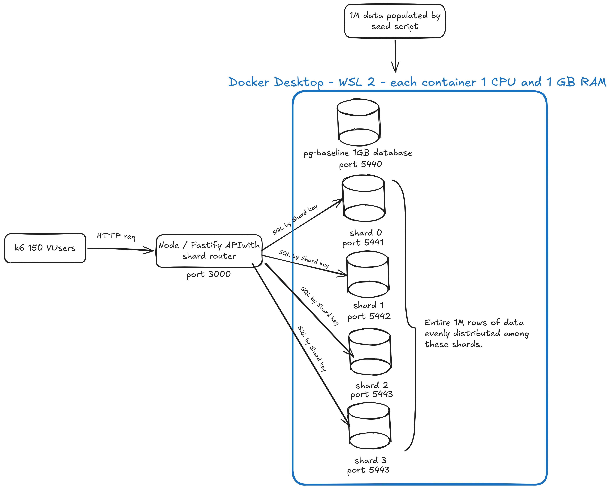
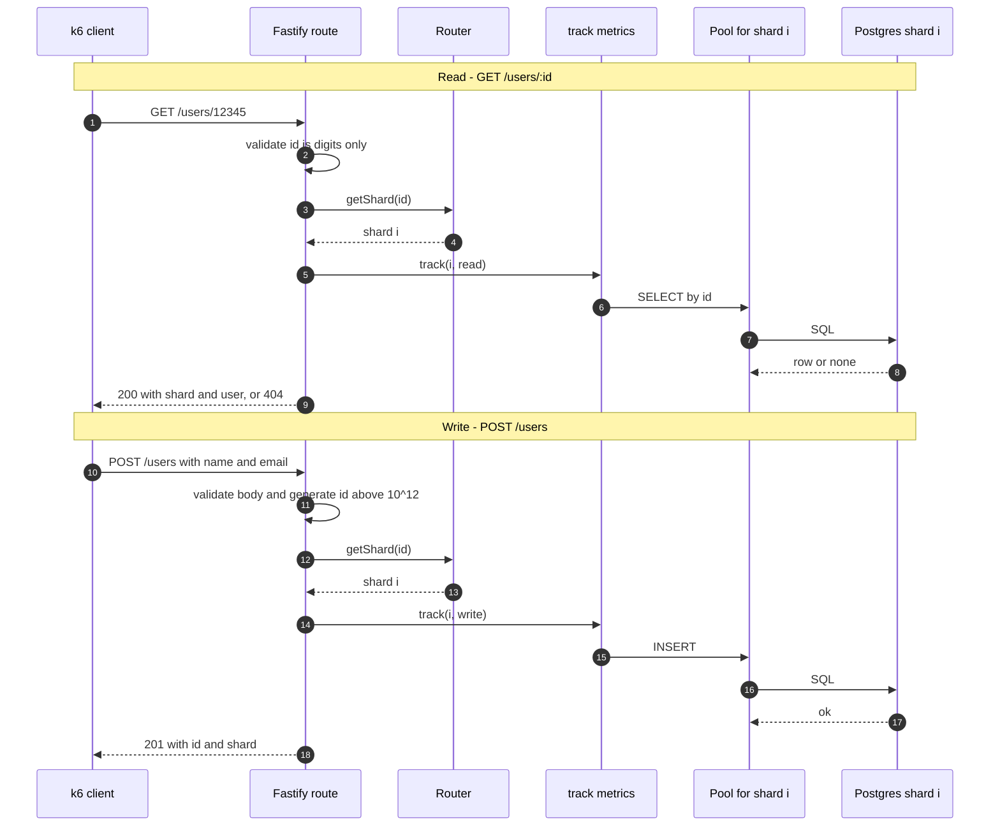
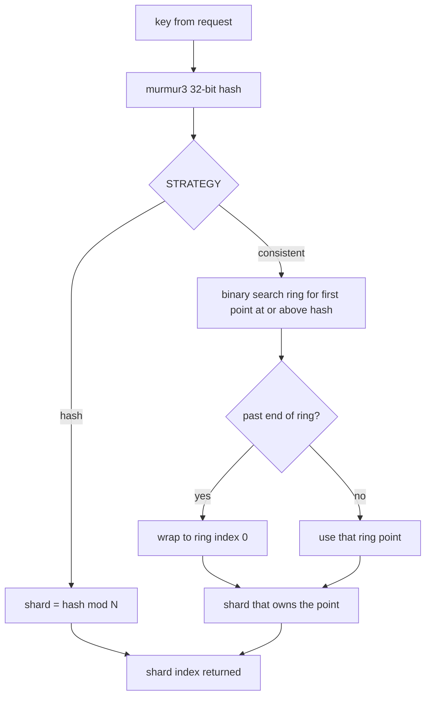

# sharding-lab

A hands-on database sharding project: a Node.js API that routes data across multiple PostgreSQL shards, seeded with millions of rows and load-tested with k6 to compare **1 database vs 2 vs 4 shards**, different routing strategies, and uniform vs skewed traffic.

## Headline findings

All numbers are from a single laptop (see [Limitations](#limitations)), averaged over two runs per setup unless stated.

1. **Hash routing balances data best (±0.1%), but resizing is expensive.** Going from 4 to 5 shards moves ~80% of keys. Consistent hashing moves ~20% and never reshuffles keys between surviving shards.
2. **Virtual nodes fix consistent hashing's imbalance cheaply.** Shard-size std dev falls from 55% (1 vnode) to 3.6% (150) and 1.7% (1000), with no measurable lookup-cost increase.
3. **Key lookups scale only modestly at this data size.** 4 shards gave +14% throughput and -12% read p95 versus 1 DB, close to run-to-run noise, because 1M rows (~104 MB) fit in memory on one node.
4. **Queries without the shard key get worse.** A scatter-gather query on 4 shards had -61% throughput and 2.7× the p95 of 1 DB. Every shard handles every query.
5. **Sharding balances data, not traffic.** Under Zipf-skewed reads the busiest shard took 29-30% with hash/consistent, 60.7% with a directory and 90% with range. A single hot key puts ~47.5% on one shard under every strategy.
6. **Range partitioning wins range queries and loses elsewhere.** It gave 2.5× the throughput of hash on an id-range query (1 shard touched instead of 4), but sent 100% of new writes to one shard.


## Why sharding

A single database server eventually hits limits on storage, write throughput, connections, or RAM for hot data. Replication scales reads but not writes, because every replica holds all the data. Sharding splits one logical database into several smaller databases (shards), each on its own server, so writes and storage scale horizontally.

The cost: cross-shard joins and transactions are hard, rebalancing is painful, queries without the shard key must ask every shard, and the application (or a router) must know where each row lives. Sharding should only come after indexing, caching, read replicas and vertical scaling are exhausted.

## Sharding techniques

| Technique | How it works | Pros | Cons | Implemented here |
|---|---|---|---|---|
| Range-based | Key ranges map to shards (e.g. id 1-1M on A, 1M-2M on B) | Efficient range queries | Hotspots; new data lands on the newest shard | Yes |
| Hash-based | `shard = hash(key) % N` | Even distribution | Changing N remaps almost every key; range queries hit all shards | Yes |
| Consistent hashing | Keys and shards sit on a hash ring; a key goes to the next shard clockwise; virtual nodes smooth the load | Adding/removing a shard moves only ~1/N of keys | Less even split; more complex | Yes |
| Directory/lookup | A table maps each key to a shard | Maximum flexibility | Directory is a bottleneck / single point of failure | Yes |
| Geo-based | Data placed by region | Low latency, data residency | Uneven load by region | No |
| Functional partitioning | Different tables/services on different DBs | Simple | Not true sharding | No |

The **shard key** matters most: high cardinality, even load, and matching the main query pattern. A bad key (country, timestamp) creates hot shards.

## Architecture

```
k6 virtual users → Node/Fastify API (shard router) → Postgres shard 0..3
```



Request flow and the routing algorithms:





- The API extracts the shard key (`id`), asks the router `getShard(id)`, and runs the query on that shard's connection pool.
- IDs are generated by the application, never `SERIAL`, because each shard has its own sequence and IDs would collide.
- The project simulates a system that was **sharded from day one**: seeding goes through the router, so each row is written straight to its shard. No single database ever holds the full dataset.
- Routers implement one `ShardRouter` interface, so strategies are swappable with the `STRATEGY` environment variable.
- Prometheus-format metrics are exposed at `/metrics` (queries and latency per shard).

## Tech stack

- **Node.js 20.6+**, TypeScript, **Fastify**
- **pg** (one `Pool` per shard), **pg-copy-streams** (bulk loading), **prom-client**
- **PostgreSQL 16** in Docker Compose (1 baseline + 4 shards, each limited to 1 CPU / 1GB RAM)
- **k6** for load testing
- **Python** (matplotlib, numpy) for the README charts
- **Prometheus + Grafana** (optional, for live dashboards)
- Cloud (AWS or GCP VMs) for the real benchmarks (planned)

## Project structure

```
sharding-lab/
├── docker-compose.yml
├── tsconfig.json
├── .env
├── sharding-HLD.png
├── db/
│   └── schema.sql
├── scripts/
│   ├── seed.ts                  # bulk seeder (goes through the router)
│   ├── rebalance-sim.ts         # 7.1, 7.2: keys moved and vnodes (offline)
│   ├── strategy-sim.ts          # 7.3, 7.4: strategies under skew (offline)
│   └── make_charts.py           # generates docs/charts/*.png
├── loadtest/
│   ├── k6.js                    # lookups + writes: ramp, steady, spike; uniform/zipf/hot keys
│   └── k6-scatter.js            # country query and id-range query
├── results/                     # k6 summary exports and simulation output (JSON)
├── docs/charts/                 # generated charts
├── monitoring/                  # optional: prometheus.yml, grafana-datasource.yml
└── src/
    ├── config.ts
    ├── metrics.ts
    ├── server.ts
    ├── db/pools.ts
    ├── routers/
    │   ├── types.ts             # ShardRouter interface (the contract)
    │   ├── hash.ts              # murmur3 + hash % N
    │   ├── consistentHash.ts    # hash ring + virtual nodes
    │   ├── range.ts             # contiguous id ranges
    │   ├── directory.ts         # bucket lookup table
    │   └── index.ts             # picks the strategy from env
    └── routes/users.ts          # GET /users/:id, POST /users, GET /users?country=, GET /users/range
```

## Setup

### Prerequisites

- Node 20.6 or newer (`node -v`)
- Docker Desktop (WSL 2 backend on Windows)
- k6 (`winget install k6 --source winget`)
- `psql` and/or pgAdmin 4 (optional, for inspecting data)
- Python 3 with `matplotlib` and `numpy` (only for generating charts)

### Install

```bash
npm install
npm i pg-copy-streams
npm i -D @types/pg-copy-streams
```

`package.json` scripts:

```json
"dev": "node --env-file=.env --import tsx src/server.ts",
"build": "tsc",
"start": "node --env-file=.env dist/server.js",
"seed": "node --env-file=.env --import tsx scripts/seed.ts",
"sim": "node --env-file=.env --import tsx scripts/rebalance-sim.ts",
"strategy-sim": "node --env-file=.env --import tsx scripts/strategy-sim.ts"
```

### Configuration (`.env`)

```
PORT=3000
STRATEGY=consistent      # hash | consistent | range | directory
POOL_SIZE=20
SEED_KEYS=1000000        # must match the seeded row count (used by range and directory)
SHARD_URLS=postgres://<user>:<password>@localhost:5441/<db>,postgres://<user>:<password>@localhost:5442/<db>,postgres://<user>:<password>@localhost:5443/<db>,postgres://<user>:<password>@localhost:5444/<db>

# 1 DB baseline (single URL, same code path)
# SHARD_URLS=postgres://<user>:<password>@localhost:5440/<db>

# 2 shards
# SHARD_URLS=postgres://<user>:<password>@localhost:5441/<db>,postgres://<user>:<password>@localhost:5442/<db>
```

A baseline run is just one URL in `SHARD_URLS`. The router always returns shard 0, so 1-DB vs sharded comparisons run the same code.

### Database credentials and ports

Docker creates every database itself from `docker-compose.yml`. All use user `app`, password `app`, database `app`. They differ only by port:

| Container | Port |
|---|---|
| pg-baseline | 5440 |
| shard0 | 5441 |
| shard1 | 5442 |
| shard2 | 5443 |
| shard3 | 5444 |

`db/schema.sql` runs automatically on the first start of each empty volume.

## Running

### Steps 1-3: build, start empty shards, smoke test

```bash
npx tsc --noEmit
docker compose up -d shard0 shard1 shard2 shard3
docker compose ps
npm run dev
```

Expected: `API :3000 | strategy=consistent | shards=4`. The baseline is started only when needed (`docker compose up -d pg-baseline`) to save RAM.

Smoke test (PowerShell):

```powershell
Invoke-RestMethod http://localhost:3000/health

$body = @{ name = "Ali"; email = "ali@example.com"; country = "PK" } | ConvertTo-Json
$r = Invoke-RestMethod -Method Post -Uri http://localhost:3000/users -ContentType "application/json" -Body $body
$r
Invoke-RestMethod "http://localhost:3000/users/$($r.id)"
Invoke-RestMethod "http://localhost:3000/debug/route/$($r.id)"   # shard must match the POST response
```

### Step 4: seed the shards

The seeder generates users with ids 1..N, asks the router which shard owns each id, groups rows per shard, and bulk-loads each shard with `COPY`. It prints rows, share and table size per shard.

Clear existing rows first (safest on Windows, since npm/PowerShell can swallow the `--truncate` flag):

```powershell
foreach ($s in "shard0","shard1","shard2","shard3") {
  docker compose exec -T $s psql -U app -d app -c "TRUNCATE users;"
}
npm run seed
```

`npm run seed` seeds 1,000,000 rows by default. The API's new ids start at 10^12, so inserts from the API never collide with seeded ids 1..N.

**Whenever you change `STRATEGY` or the shard list:** truncate, update `.env`, re-seed, and restart the API. Data placed by one configuration is only readable under that same configuration.

**Result: hash vs consistent hashing data distribution** (1,000,000 rows, 4 shards, consistent hashing with 150 virtual nodes per shard):

| | Hash | Consistent |
|---|---|---|
| Shard 0 | 249,933 (24.99%) | 239,224 (23.92%) |
| Shard 1 | 249,466 (24.95%) | 257,423 (25.74%) |
| Shard 2 | 250,640 (25.06%) | 242,881 (24.29%) |
| Shard 3 | 249,961 (25.00%) | 260,472 (26.05%) |
| Largest ÷ smallest shard | 1.005× | 1.089× |
| Table size per shard | 26 MB | 25-27 MB |

- Hash routing spreads rows almost perfectly evenly.
- Consistent hashing is less even (about 9% between the biggest and smallest shard). More virtual nodes tighten the split (see Step 7.2).
- Consistent hashing's advantage is **rebalancing**: see Step 7.1.

### Step 5: load test with k6

`loadtest/k6.js` sends HTTP traffic to the API: 90% `GET /users/:id` (seeded ids) and 10% `POST /users`. Stages: ramp up, steady, 3× spike, hold, ramp down (150 virtual users at peak, 2.5 minutes). Options are set with `-e`:

| Variable | Default | Meaning |
|---|---|---|
| `SKEW` | `uniform` | `uniform`: all ids equally likely. `zipf`: a few ids get most reads. `hot` (optional extension): 30% of reads hit one key |
| `READ_RATIO` | `0.9` | Fraction of reads |
| `PEAK_VUS` | `50` | Steady-state users (spike is 3×) |
| `N` | `1000000` | Seeded rows (ids 1..N) |

```powershell
mkdir results

# quick check
k6 run --vus 5 --duration 10s loadtest/k6.js

# full run
k6 run --summary-export results/consistent-4shards-uniform.json loadtest/k6.js

# skewed keys
k6 run -e SKEW=zipf --summary-export results/consistent-4shards-zipf.json loadtest/k6.js

# per-shard load (restart the API before each run to reset the counters)
(Invoke-RestMethod http://localhost:3000/metrics) -split "`n" | Select-String "shard_queries_total"
```

**First 4-shard runs** (consistent hashing, 150 peak users, single runs):

| | Uniform keys | Zipf keys |
|---|---|---|
| Requests | 96,992 | 108,245 |
| Read p95 | 260 ms | 246 ms |
| Write p95 | 303 ms | 308 ms |
| Errors | 0% | 0% |

These two single runs predate the fresh-seed, two-run protocol used from Step 6 on, so their throughput and latency are not comparable with the Step 6 numbers (the uniform run, 646 req/s, was an outlier against the 856 req/s measured in Step 6). Their value is the per-shard distribution:

| Shard | Seeded data | Uniform traffic | Zipf traffic |
|---|---|---|---|
| 0 | 23.9% | 23.7% | 28.2% |
| 1 | 25.7% | 25.9% | 22.4% |
| 2 | 24.3% | 24.3% | 21.2% |
| 3 | 26.1% | 26.1% | 28.2% |
| Busiest ÷ quietest | 1.09× | 1.10× | 1.34× |

- With uniform keys, each shard's share of traffic matches its share of the data, so consistent hashing's ring imbalance becomes real load imbalance.
- Skewed (Zipf) reads concentrate on the shards that own the popular ids: two shards took ~28% each versus ~21% for the others. **Sharding balances where data is stored, not how often each row is read.**
- There was no latency penalty locally: no shard was near saturation, hot rows are cached, and all components share one laptop's CPU. A hot shard only hurts once it becomes the limiting resource.
- Mitigations for a hot shard: cache hot keys (Redis), read replicas for the hot shard, splitting a hot key, or a shard key with less skewed access.

### Step 6: 1 DB vs 2 vs 4 shards (1M rows, consistent hashing, uniform keys, 150 peak users)

Two runs per setup, fresh seed per setup. Averages shown; raw runs in `results/`.

| Setup | Req/s | Read p95 | Write p95 | Errors |
|---|---|---|---|---|
| 1 DB | 752 | 209 ms | 380 ms | 0% |
| 2 shards | 818 | 206 ms | 422 ms | 0% |
| 4 shards | 856 | 183 ms | 330 ms | 0% |


Findings:

- Throughput rises modestly with shard count (+14% from 1 DB to 4 shards) and read p95 falls ~12%.
- The effect is small and close to run-to-run noise (4-8% between identical runs). Write p95 is too noisy to rank.
- At 1M rows (~104 MB) one database fits in memory, and k6, the single-process Node API and all databases share one laptop's CPU, so the single node is not the bottleneck. Sharding pays off when a node is saturated (data larger than RAM, CPU or disk limits), which is the cloud experiment.
- Per-shard traffic follows each shard's share of the data (1.08× busiest vs quietest in the 4-shard run).

### Step 7.1: Keys moved when the shard count changes (1M keys)

| Change | Strategy | Keys moved | Ideal | Reshuffled between existing shards |
|---|---|---|---|---|
| 4 → 5 shards | hash | 79.98% | 20% | 60.06% |
| 4 → 5 shards | consistent | 19.62% | 20% | 0.00% |
| 4 → 3 shards | hash | 74.93% | 25% | 49.94% |
| 4 → 3 shards | consistent | 26.05% | 25% | 0.00% |


Hash routing moves about 4× more data than necessary when the shard count changes, and a large share of that moves between shards that still exist. Consistent hashing moves only the new (or removed) shard's slice and never reshuffles surviving shards.

### Step 7.2: Virtual nodes vs balance (4 shards, 1M keys)

| vnodes | Busiest ÷ quietest | Std dev | Keys moved 4 → 5 |
|---|---|---|---|
| 1 | 5.39× | 55.5% | 3.19% |
| 10 | 2.27× | 30.3% | 27.97% |
| 50 | 1.26× | 8.5% | 18.76% |
| 150 | 1.09× | 3.6% | 19.62% |
| 500 | 1.08× | 3.2% | 20.02% |
| 1000 | 1.05× | 1.7% | 20.66% |
| hash (reference) | 1.005× | 0.2% | 79.98% |


Balance improves sharply up to ~50-150 vnodes, then with diminishing returns. Too few vnodes give both a lopsided split and unpredictable rebalancing. Lookup cost stayed flat (261-411 ns per lookup, dominated by the hash itself), so large vnode counts are effectively free.

### Step 7.3 and 7.4: Routing strategies under different traffic (4 shards, 1M ids, offline simulation)

Share of load on the busiest shard (ideal: 25%):

| Scenario | Hash | Consistent | Range | Directory |
|---|---|---|---|---|
| Seeded data | 25.1% | 26.0% | 25.0% | 25.0% |
| New writes (ids above 10^12) | 25.1% | 26.0% | 100% | 25.1% |
| Uniform reads | 25.1% | 26.0% | 25.1% | 25.0% |
| Zipf reads | 29.6% | 28.6% | 90.0% | 60.7% |
| Hot key (30% of reads on id 1) | 47.5% | 48.1% | 47.5% | 47.5% |


Findings:

- Range partitioning balances seeded data perfectly but sends every new insert to the last shard and concentrates popular low ids on shard 0 (90% under Zipf).
- A directory keeps neighbouring ids together, so a hot head of the id space lands on one shard (60.7% under Zipf). It can be fixed by moving buckets, at the cost of a migration.
- Hash and consistent routing scatter popular ids, keeping Zipf skew mild (~29%).
- No routing strategy fixes a single extremely hot key (~47.5% on one shard in every case). That needs caching, replicas or key splitting.
- The simulation reproduces the real k6 per-shard counters for consistent hashing (Zipf: 28.2 / 22.4 / 21.2 / 28.2 measured vs 28.6 / 22.2 / 20.7 / 28.5 simulated). Range, directory and hot-key results come from the simulation only.

### Step 7.5a: Scatter-gather (query on a non-shard-key column), consistent hashing

`GET /users?country=PK&limit=50` has no shard key, so every shard is queried in parallel and the results merged. Two runs per setup, averages shown.

```powershell
k6 run -e MODE=country --summary-export results/scatter-country-4shards-a.json loadtest/k6-scatter.js
```

| Setup | Req/s | p95 | Avg latency | Shards touched per query |
|---|---|---|---|---|
| 1 DB | 712 | 224 ms | 102 ms | 1 |
| 2 shards | 493 | 358 ms | 147 ms | 2 |
| 4 shards | 281 | 598 ms | 259 ms | 4 |

Findings:

- Every shard's `scan` counter equalled the total request count, confirming that each query fans out to all shards.
- Throughput fell ~61% and p95 rose ~2.7× going from 1 DB to 4 shards, far beyond run-to-run noise (6-10%).
- Total database queries per second rose with shard count (712 → 986 → 1,122), but each request now costs N shard queries plus a merge in the API, so useful throughput fell.
- Contrast with key lookups (Step 6): the same 4-shard cluster gave +14% throughput for lookups by id but -61% for this query. Sharding helps queries that carry the shard key and hurts those that don't.
- Mitigations: route by the field most queries use, maintain a global secondary index or lookup table, send such queries to a search index or read replica, and keep scatter-gather off hot paths.

### Step 7.5b: Id-range query across routing strategies (4 shards, 1,000-id range, 150 peak users)

`GET /users/range?from=X&to=X+999` — strategies that can narrow the range ask fewer shards. Two runs per strategy, averages shown.

```powershell
k6 run -e MODE=range --summary-export results/scatter-range-hash-a.json loadtest/k6-scatter.js
```

| Strategy | Req/s | p95 | Avg latency | Shards touched per query |
|---|---|---|---|---|
| hash | 293 | 541 ms | 248 ms | 4.00 |
| consistent | 305 | 525 ms | 238 ms | 4.00 |
| range | 735 | 222 ms | 99 ms | 1.00 |
| directory | 449 | 423 ms | 161 ms | 2.00 |


Findings:

- Hash and consistent routing cannot narrow a range, so every query fans out to all 4 shards (counters equal the request count on every shard).
- Range routing sends the query to one shard (only ~0.3% of queries straddle a boundary): 2.5× the throughput and 59% lower p95 than hash.
- The directory touched exactly 2 shards: a 1,000-id span matches the 1,000-id bucket size, so it nearly always straddles two buckets, and round-robin placement puts neighbouring buckets on different shards. Placing consecutive buckets on the same shard would cut fan-out, at the cost of spreading load.
- Throughput tracks fan-out but not proportionally (4 shards: 293, 2: 449, 1: 735 req/s) because of fixed per-request API work.
- Range partitioning wins range queries but loses on new writes (100% on one shard) and popular keys (90% on shard 0 under Zipf), so the choice depends on the workload.

### Optional: live dashboards (Prometheus + Grafana)

Add `prometheus` and `grafana` services to `docker-compose.yml` (Grafana on port 3001) and a `monitoring/prometheus.yml` that scrapes `host.docker.internal:3000`. Useful panels:

- `sum by (shard) (rate(shard_queries_total[15s]))`: queries/s per shard (balance or hot shard)
- `histogram_quantile(0.95, sum by (le, shard) (rate(shard_query_seconds_bucket[30s])))`: p95 DB latency per shard
- `rate(process_cpu_seconds_total[15s])` and `nodejs_eventloop_lag_seconds`: is Node the bottleneck?

k6 can push its own metrics with `-o experimental-prometheus-rw` (Prometheus started with `--web.enable-remote-write-receiver`).

### Stopping

```bash
docker compose stop      # pause, keep data
docker compose start     # resume
docker compose down      # remove containers, keep data volumes
docker compose down -v   # remove everything INCLUDING data
```

### Inspecting data in pgAdmin 4

Register each shard as a server: Host `127.0.0.1`, Port 5441-5444 (5440 for the baseline), Maintenance database `app`, Username `app`, Password `app`. Use `SELECT count(*) FROM users;` for real row counts. Avoid "View All Rows" on large tables.

## Which strategy when

| Strategy | Resize cost (4 → 5) | Data balance | New writes | Zipf reads (busiest shard) | Id-range query |
|---|---|---|---|---|---|
| hash | 80% of keys move | 1.005× | even | 29.6% | 4 shards, 293 req/s |
| consistent | 20% move | 1.09× | even | 28.6% | 4 shards, 305 req/s |
| range | not measured | 1.0× | 100% on one shard | 90.0% | 1 shard, 735 req/s |
| directory | not measured | 1.0× | even | 60.7% | 2 shards, 449 req/s |

| If your workload looks like... | Use | Why |
|---|---|---|
| Even load, fixed shard count, lookups by key | Hash | Best balance, simplest |
| You expect to add or remove shards | Consistent hashing | Moves ~20% of data instead of ~80% |
| Range queries or time-based data, and inserts are not monotonically increasing | Range | Neighbouring rows stay together |
| Multi-tenant, or you need to move one big customer by hand | Directory | Full control, at the cost of managing the table |
| One extremely hot key | None of them | Use a cache, replicas or key splitting |

Whichever strategy you pick, queries that don't include the shard key will be scatter-gather. Route by the field most queries use, or maintain a global index or a separate search system for the rest.

## Dataset size guide

Users table with primary key index:

| Rows | Baseline (1 DB) | Per shard (4 shards) |
|---|---|---|
| 1M | ~104 MB | ~26 MB |
| 10M | ~1 GB | ~260 MB |
| 50M | ~5 GB | ~1.3 GB |

At 1M rows each shard fits entirely in RAM, so a single DB and four shards perform alike for key lookups locally. The gap should appear when the data exceeds one node's memory (roughly 10M+ rows), which is what the cloud runs are for.

## Limitations

- **One laptop.** The databases, the API and k6 all share one machine's CPU, and the API is a single Node process. The database was never the bottleneck, so sharding's benefit for lookups was small. Realistic scaling results need separate cloud VMs.
- **Small dataset.** 1M rows (~104 MB) fit in memory on one node. Sharding pays off when data exceeds a node's memory or a node saturates.
- **Noise.** Two runs per setup, with run-to-run variation of roughly 1-10%. Small differences (such as the 1 DB vs 2 shards lookup throughput) should not be over-read.
- **Simulation for some results.** Range, directory and hot-key traffic shares come from an offline simulation validated against real k6 counters for one strategy. Resize cost for range and directory was not measured.
- **Directory table is static.** The lookup table is built from configuration, not stored in a database, and bucket moves were not benchmarked.
- **Not implemented:** replication, cross-shard transactions and online resharding.

## Future work

- Run the benchmark on separate cloud VMs with 10-50M rows and data larger than one node's memory, using a stepped arrival-rate test to find each setup's saturation point.
- Online resharding (4 → 5 shards under load) with dual reads and a verified cutover.
- Write-heavy mixes (`-e READ_RATIO=0.2`), a global secondary index, and Prometheus and Grafana dashboards.
- Use synthetic data for controlled experiments (uniform vs skewed keys), plus one real dataset (e.g. NYC taxi or Amazon Reviews) for a realistic final demo.
- In the cloud, run several API instances behind a load balancer, or Node itself becomes the bottleneck and hides the shard differences.

## Reproducing the results

```bash
npm run sim                 # 7.1, 7.2 -> results/rebalance-sim.json
npm run strategy-sim        # 7.3, 7.4
k6 run --summary-export results/<name>.json loadtest/k6.js
k6 run -e SKEW=zipf    --summary-export results/<name>.json loadtest/k6.js
k6 run -e MODE=country --summary-export results/<name>.json loadtest/k6-scatter.js
k6 run -e MODE=range   --summary-export results/<name>.json loadtest/k6-scatter.js
python scripts/make_charts.py
```

Restart the API before each k6 run so the per-shard counters (`/metrics`, `shard_queries_total`) start from zero, and check `/health` shows the expected strategy and shard count.

## Troubleshooting

- **`TS5108: moduleResolution=node10 has been removed`:** newer TypeScript. Use `"module": "node16"`, `"moduleResolution": "node16"` and `"types": ["node"]` in `tsconfig.json`.
- **Invalid JSON body from `curl.exe` in PowerShell:** PowerShell mangles escaped quotes. Use `Invoke-RestMethod` with `ConvertTo-Json`.
- **`params/id must match pattern`:** a non-numeric id was sent (e.g. a pasted placeholder). Use `$r.id` from the POST response.
- **Seed fails with `duplicate key value violates unique constraint "users_pkey"`:** rows from an earlier seed are still there. Truncate every shard (loop above) and re-run `npm run seed`. The `--truncate` flag may not reach the script through npm on PowerShell.
- **Reads return 404 after switching strategy or shard list:** the data was seeded under a different configuration than the API is running. Truncate, re-seed and restart the API.
- **Metrics counters include earlier traffic:** counters are cumulative since the API started. Restart the API before each run.
- **pgAdmin "password authentication failed":** the shard password is `app`, set in `docker-compose.yml`. It is read only when a volume is first created.
- **pgAdmin can't connect to port 5440:** the baseline container isn't running. Start it with `docker compose up -d pg-baseline`.
- **Docker Desktop "not enough disk space" on a low C: drive:** install with separate folders on another drive, e.g. `--installation-dir=E:\DockerApp --wsl-default-data-root=E:\DockerData` (the data root must not be inside the install dir) and set `TEMP`/`TMP` to a folder on that drive for the install.
- **`docker` or `k6` not recognized after install:** open a new terminal; if still missing, add the install folder to the user PATH.

## Roadmap

- [x] Step 1: Code: API, hash and consistent-hash routers, metrics
- [x] Step 2: Infrastructure: 4 empty Postgres shards via Docker Compose
- [x] Step 3: Smoke test: routing verified, rows spread evenly
- [x] Step 4: Seed 1M rows through the router with batched `COPY`; compared hash vs consistent distribution
- [x] Step 5: k6 load test implemented; 4-shard runs recorded (uniform and Zipf keys)
- [x] Step 6: Compare 1 DB vs 2 shards vs 4 shards under identical data and load
- [x] Step 7: Routing experiments: keys moved on resize (7.1), virtual nodes (7.2), range and directory routers under skew (7.3, 7.4), scatter-gather and id-range queries (7.5)
- [x] Step 8: Results, charts and trade-off analysis
- [ ] Optional: write-heavy mix (7.6), online resharding (7.7), 5M-row run with tight memory limits (6b)
- [ ] Optional: Grafana dashboards; 10-50M rows on cloud VMs